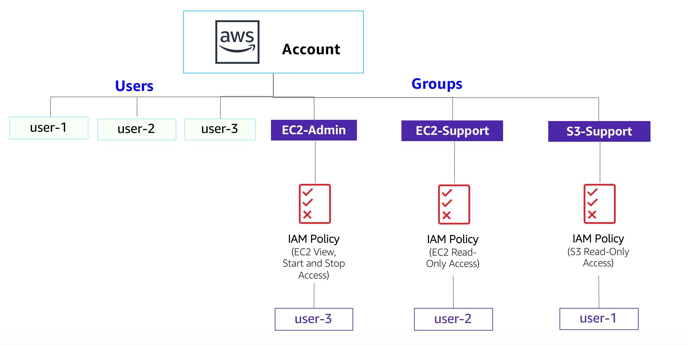
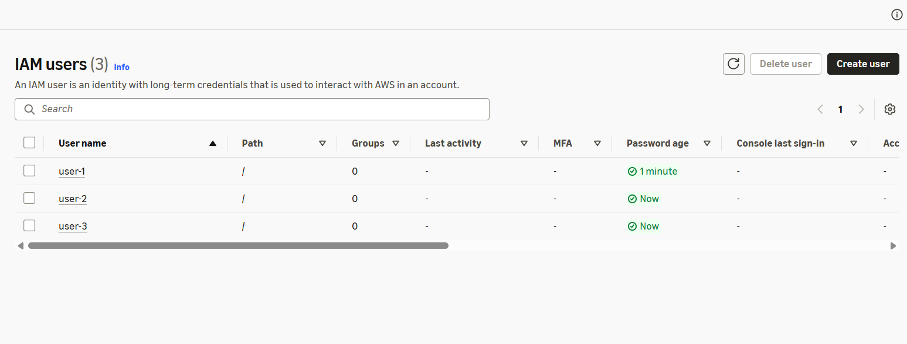
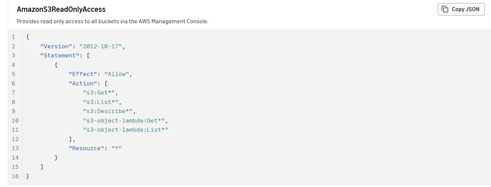
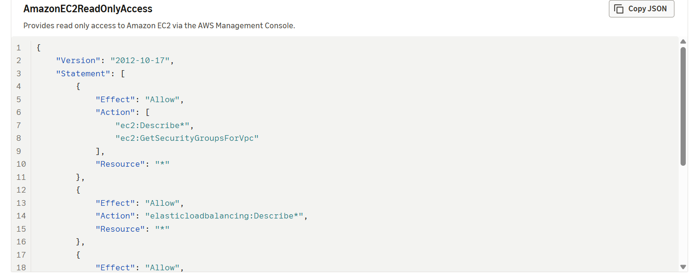
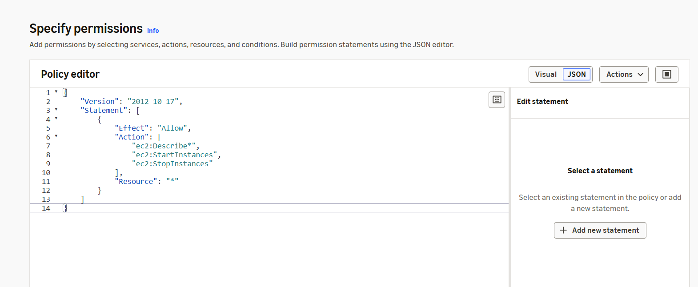
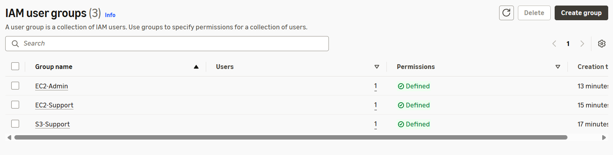
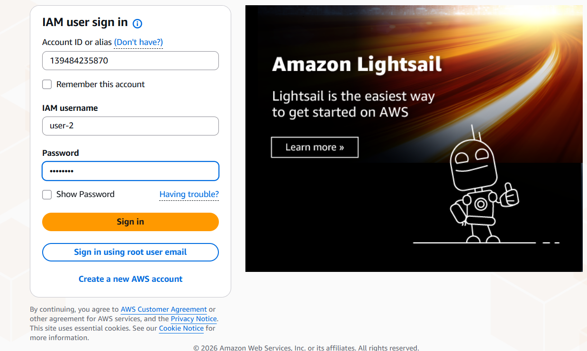
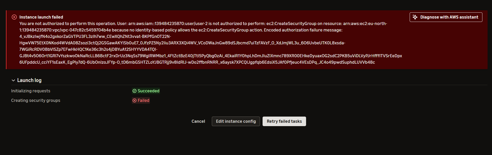

# AWS IAM Lab: Users, Groups and Policies

My first hands-on AWS lab. I created IAM users and groups manually in the AWS Management Console and gave each group the permissions it needs, following the principle of least privilege.

## Lab Scenario



| User   | Group       | Permissions                          |
|--------|-------------|--------------------------------------|
| user-1 | S3-Support  | S3 read-only access                  |
| user-2 | EC2-Support | EC2 read-only access                 |
| user-3 | EC2-Admin   | EC2 view, start and stop instances   |

## Steps

### 1. Create the IAM users

From **IAM > Users > Create user**, I created `user-1`, `user-2` and `user-3` with console access enabled. At this point none of them belongs to any group (the **Groups** column shows `0`).



### 2. Create the S3-Support group

Created the group `S3-Support` and attached the AWS managed policy **AmazonS3ReadOnlyAccess**. It allows `s3:Get*`, `s3:List*` and `s3:Describe*` on all buckets, and nothing else.



Then added `user-1` to this group.

### 3. Create the EC2-Support group

Created the group `EC2-Support` and attached the AWS managed policy **AmazonEC2ReadOnlyAccess**. It allows `ec2:Describe*` (plus related read-only actions such as Elastic Load Balancing describe calls), so the user can view resources but not change them.



Then added `user-2` to this group.

### 4. Create the EC2-Admin group with a custom policy

There is no AWS managed policy that gives exactly "view + start + stop", so I created an **inline policy** from the JSON editor inside the `EC2-Admin` group:

```json
{
    "Version": "2012-10-17",
    "Statement": [
        {
            "Effect": "Allow",
            "Action": [
                "ec2:Describe*",
                "ec2:StartInstances",
                "ec2:StopInstances"
            ],
            "Resource": "*"
        }
    ]
}
```



Then added `user-3` to this group.

### 5. Final result

All three groups exist, each has one user and its permissions are defined.



# Test User

###  User login

Log in using your username and password.



###  User Permissions

It can't create an instance, it can only view.



## Expected Behavior

| User   | Should work                          | Should be denied              |
|--------|--------------------------------------|-------------------------------|
| user-1 | List and read S3 buckets             | Anything in EC2               |
| user-2 | View EC2 instances                   | Start or stop instances, S3   |
| user-3 | View, start and stop EC2 instances   | Anything in S3                |


