# AWS VPC Lab: Public & Private Subnets with NAT Gateway

Build a custom VPC across two Availability Zones with public and private subnets, an Internet Gateway, a NAT Gateway, and a web server running in a public subnet.

**Region:** `eu-north-1` (Stockholm) | **AZs:** `eu-north-1a` (A) and `eu-north-1b` (B)

## Architecture

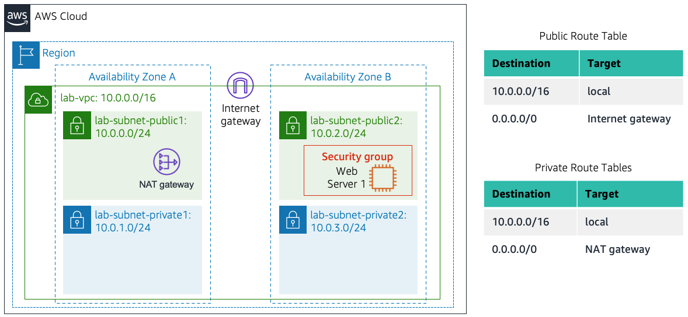

| Resource | Name | Details |
|---|---|---|
| VPC | `lab-vpc` | `10.0.0.0/16` |
| Public subnet 1 | `lab-subnet-public1` | `10.0.0.0/24` (AZ A) |
| Private subnet 1 | `lab-subnet-private1` | `10.0.1.0/24` (AZ A) |
| Public subnet 2 | `lab-subnet-public2` | `10.0.2.0/24` (AZ B) |
| Private subnet 2 | `lab-subnet-private2` | `10.0.3.0/24` (AZ B) |
| Internet Gateway | `lab-igw` | Attached to `lab-vpc` |
| NAT Gateway | `lab-nat` | In `lab-subnet-public1`, with an Elastic IP |
| Security group | `web-sg` | HTTP 80 and SSH 22 inbound |
| EC2 | `Web Server 1` | `t3.micro`, in `lab-subnet-public2` |

### Target route tables

| Public route table (`lab-public-rt`) | | Private route table (`lab-private-rt`) | |
|---|---|---|---|
| **Destination** | **Target** | **Destination** | **Target** |
| `10.0.0.0/16` | local | `10.0.0.0/16` | local |
| `0.0.0.0/0` | **Internet gateway** | `0.0.0.0/0` | **NAT gateway** |

---

## Step 1: Create the VPC
VPC Console > **Create VPC** > **VPC only** > Name `lab-vpc`, IPv4 CIDR `10.0.0.0/16`.

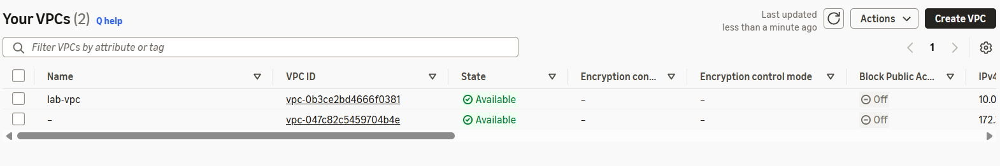

## Step 2: Create the subnets
VPC Console > **Subnets** > **Create subnet** > select `lab-vpc` and add the four subnets from the table above.

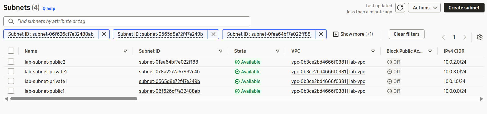

## Step 3: Create and attach the Internet Gateway
**Internet gateways** > **Create** (`lab-igw`) > **Actions** > **Attach to VPC** > `lab-vpc`.

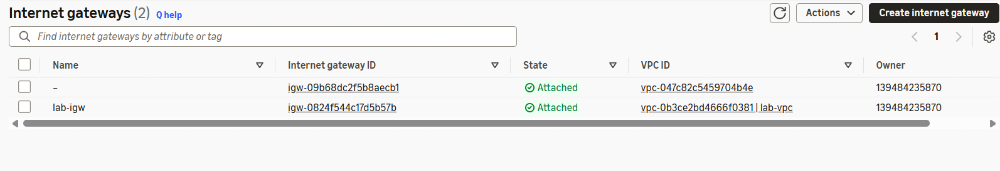

## Step 4: Create the NAT Gateway
**NAT gateways** > **Create** > Name `lab-nat`, Subnet **`lab-subnet-public1`**, Connectivity **Public**, **Allocate Elastic IP**. Wait until the state is **Available**.

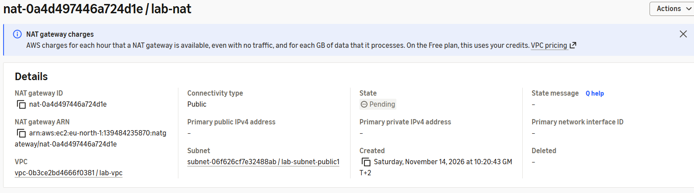

> The NAT Gateway is billed per hour, even with no traffic. Delete it when you finish.

## Step 5: Public route table
Create `lab-public-rt` in `lab-vpc`, then:
- Add route `0.0.0.0/0` > **Internet Gateway** (`lab-igw`)
- **Subnet associations** > `lab-subnet-public1` and `lab-subnet-public2`

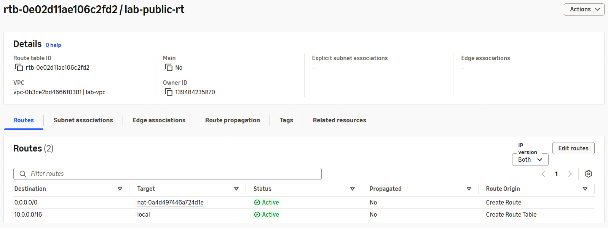

## Step 6: Private route table
Create `lab-private-rt` in `lab-vpc`, then:
- Add route `0.0.0.0/0` > **NAT Gateway** (`lab-nat`)
- **Subnet associations** > `lab-subnet-private1` and `lab-subnet-private2`

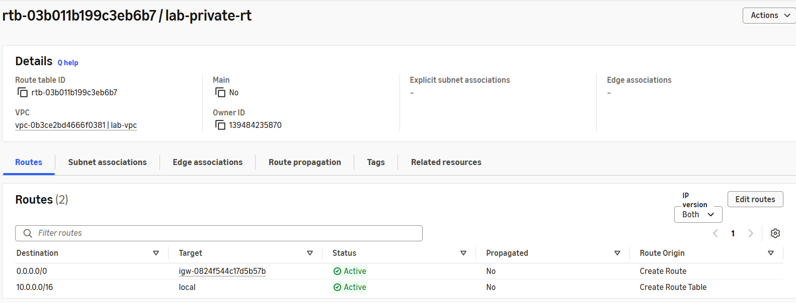

> **Note:** the two screenshots above were captured with the targets swapped (public pointing to NAT, private pointing to IGW) and with no subnet associations. See [Troubleshooting](#troubleshooting). Replace them with fresh screenshots after fixing.

## Step 7: Security group
**Security groups** > **Create** > Name `web-sg`, VPC `lab-vpc`.

| Type | Port | Source |
|---|---|---|
| HTTP | 80 | `0.0.0.0/0` |
| SSH | 22 | My IP (or as the lab requires) |

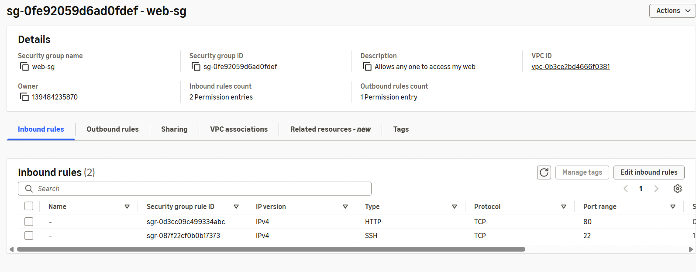

## Step 8: Launch the web server
**EC2** > **Launch instance**:
- Name: `Web Server 1`
- AMI: Amazon Linux 2023, type `t3.micro`
- Network: VPC `lab-vpc`, subnet **`lab-subnet-public2`**, **Auto-assign public IP: Enable**
- Security group: existing `web-sg`
- **Advanced details > User data:**

```bash
#!/bin/bash
# Install Apache Web Server and PHP
dnf install -y httpd wget php mariadb105-server
# Download Lab files
wget https://aws-tc-largeobjects.s3.us-west-2.amazonaws.com/CUR-TF-100-ACCLFO-2/2-lab2-vpc/s3/lab-app.zip
unzip lab-app.zip -d /var/www/html/
# Turn on web server
chkconfig httpd on
service httpd start
```


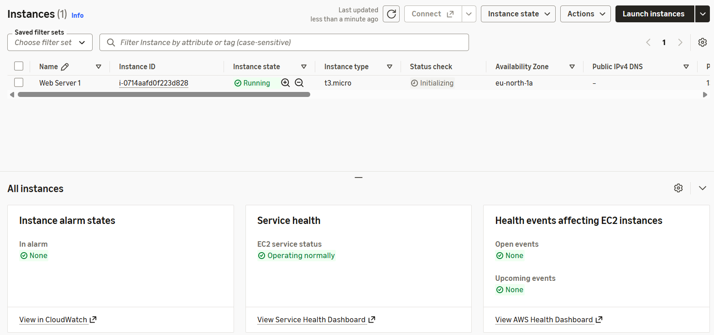

## Step 9: Test
Open `http://<Public-IPv4>` in the browser. Use **http**, not https.

---

## Troubleshooting

The web page did not open. Cause and fix:

### 1. Route tables were swapped / not associated
| | Found | Should be |
|---|---|---|
| `lab-public-rt` | `0.0.0.0/0` > NAT | `0.0.0.0/0` > **Internet gateway** |
| `lab-private-rt` | `0.0.0.0/0` > IGW | `0.0.0.0/0` > **NAT gateway** |
| Subnet associations | none | public subnets > public RT, private subnets > private RT |

Because `lab-subnet-public2` was not associated with a route table that has an IGW route, the instance had no internet path in either direction. This also breaks the User data script, since `dnf install` and `wget` both need internet access, so Apache and the lab app were never installed.

**Fix:** edit both routes, associate the subnets, then re-run the setup (next point).

### 2. User data runs only on first boot
After fixing the routes, either launch a fresh instance, or connect and run:

```bash
#!/bin/bash
dnf install -y httpd
systemctl enable --now httpd
echo "<h1>Web Server 1 - lab-vpc</h1>" > /var/www/html/index.html
```

(`chkconfig`/`service` are Amazon Linux 2 commands; on Amazon Linux 2023 prefer `systemctl`.)

### 3. Other checks
- `web-sg` allows HTTP 80 from `0.0.0.0/0`
- `lab-igw` is **Attached** to `lab-vpc`
- The instance has a public IPv4 address
- Network ACL is the default (allow all)

---

## Resource Map
It generally illustrates the architectural form.


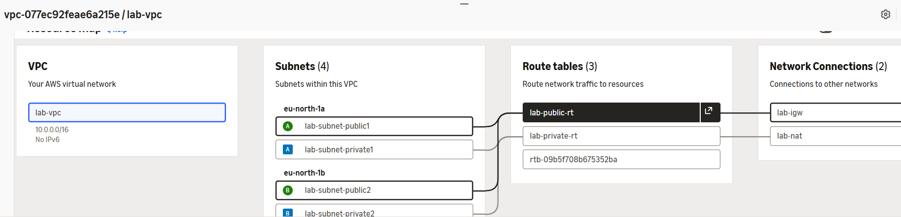

---
# Finally
## Web
A webpage accessed via an IP address using the HTTP protocol.

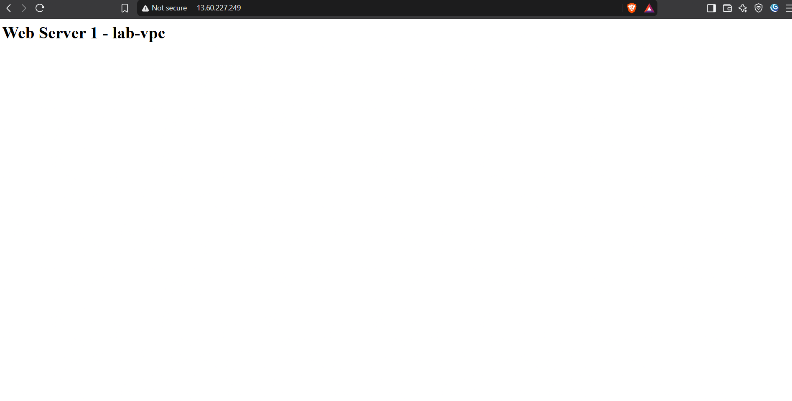

## Thank you! I have completed the lab.

