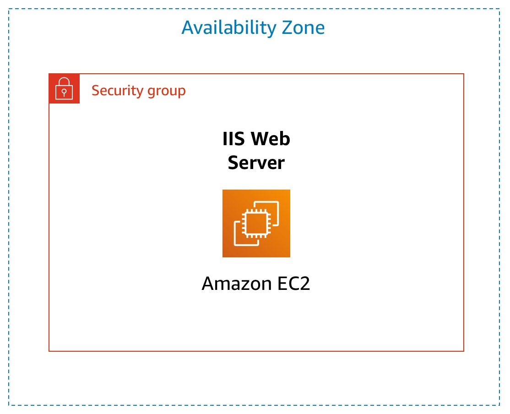
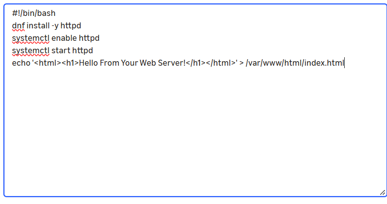
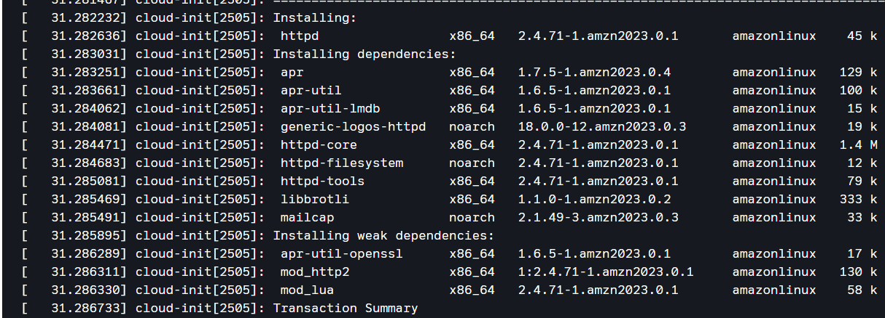
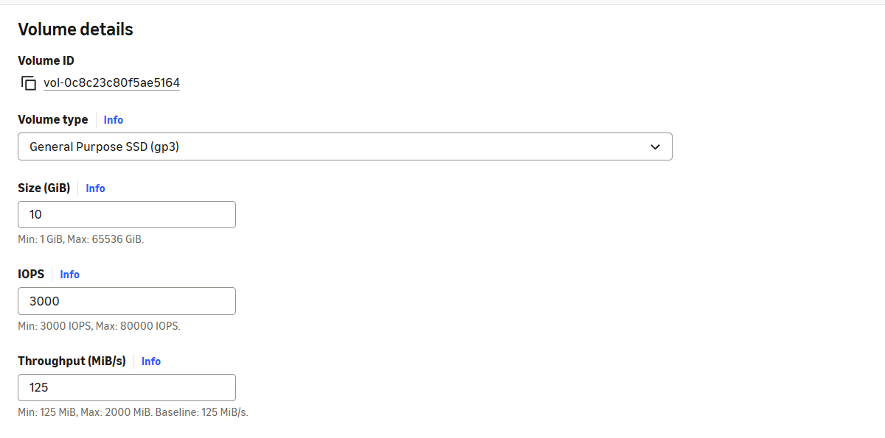
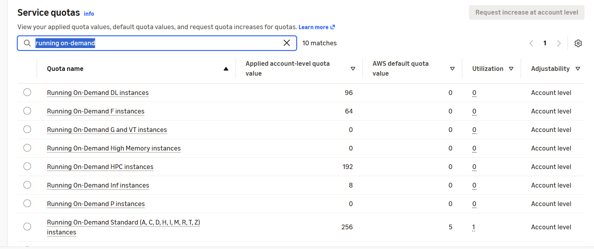

# Lab: Introduction to Amazon EC2

A hands-on lab covering how to launch, monitor, secure, resize, and stop an Amazon EC2 instance running a simple Apache web server.

**Region:** N. Virginia (`us-east-1`)  
**Duration:** ~35 minutes

## Architecture



A single EC2 instance runs inside a Security Group in one Availability Zone. The Security Group acts as a virtual firewall and controls which traffic can reach the web server.

> Note: the diagram labels the server "IIS Web Server", but this lab actually deploys **Apache (`httpd`)** on **Amazon Linux 2023**.

## Objectives

- Launch a web server with termination protection enabled
- Monitor the EC2 instance
- Modify the Security Group to allow HTTP access
- Resize the instance and enable stop protection
- Explore EC2 service limits
- Test stop protection
- Stop the EC2 instance

## Tasks

### Task 1: Launch the EC2 Instance

| Setting | Value |
|---|---|
| Name | `Web Server` |
| AMI | Amazon Linux 2023 |
| Instance type | `t2.micro` |
| Key pair | `vockey` |
| VPC | `Lab VPC` (PublicSubnet1) |
| Security group name | `Web Server security group` |
| Description | `Security group for my web server` |
| Inbound rules | Default rule removed |
| Storage | 8 GiB (default) |
| Termination protection | Enabled |

The following **User Data** script installs and starts Apache and creates a simple web page at boot:



```bash
#!/bin/bash
dnf install -y httpd
systemctl enable httpd
systemctl start httpd
echo '<html><h1>Hello From Your Web Server!</h1></html>' > /var/www/html/index.html
```

### Task 2: Monitor the Instance

Reviewed the **Status checks** (2/2 passed), the **Monitoring** tab (CloudWatch metrics), the **system log**, and the **instance screenshot**.

The system log confirms that `httpd` and its dependencies were installed by `cloud-init` from the User Data script:



### Task 3: Update the Security Group and Access the Web Server

Opening the public IP at first failed because the Security Group had no inbound rule for port 80.

Fix: added an inbound rule to `Web Server security group`:

| Type | Protocol | Port | Source |
|---|---|---|---|
| HTTP | TCP | 80 | Anywhere-IPv4 (`0.0.0.0/0`) |

After saving the rule, the web page loads successfully:


### Task 4: Resize the Instance (Type and EBS Volume)

1. Stopped the instance.
2. Changed the instance type from `t2.micro` to **`t2.small`**.
3. Enabled **stop protection**.
4. Modified the root EBS volume from **8 GiB** to **10 GiB**:



5. Started the instance again. It now shows as `t2.small`:


### Task 5: Explore EC2 Limits

Used **Service Quotas** to view the EC2 limits for the region (searched for `running on-demand`). For example, the **Running On-Demand Standard (A, C, D, H, I, M, R, T, Z) instances** quota is shown below:



### Task 6: Test Stop Protection

1. Tried to stop the instance. It failed with an error mentioning the `disableApiStop` attribute, which confirms stop protection works.
2. Disabled stop protection via **Actions > Instance settings > Change stop protection**.
3. Stopped the instance successfully.

## Key Concepts

| Concept | Description |
|---|---|
| EC2 | Resizable virtual servers in the cloud |
| AMI | Template used to launch an instance (OS and software) |
| User Data | Script that runs at first boot to automate setup |
| Security Group | Virtual firewall controlling inbound and outbound traffic |
| CloudWatch | Metrics and monitoring for AWS resources |
| Termination protection | Prevents accidental deletion of the instance |
| Stop protection | Prevents accidental stopping of the instance |
| Service Quotas | Per-region limits on AWS resources |

## Result

- Deployed an Apache web server on EC2 with automated setup via User Data
- Opened HTTP access using a Security Group rule
- Resized the instance to `t2.small` and the root volume to 10 GiB
- Verified termination and stop protection behavior
