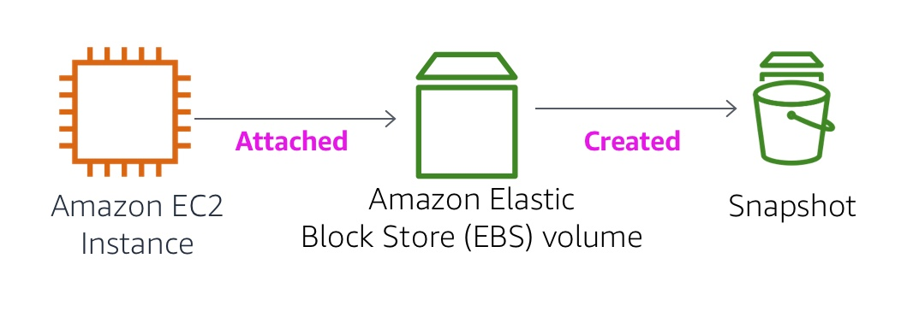
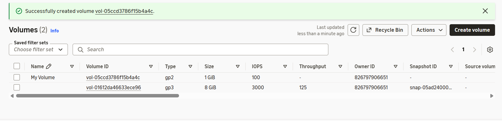
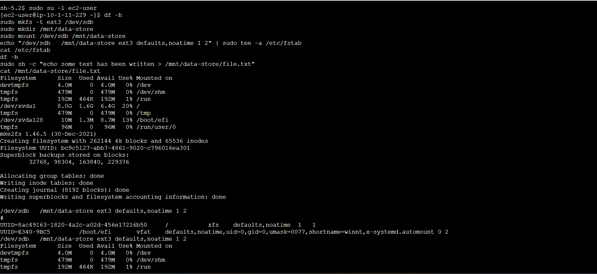
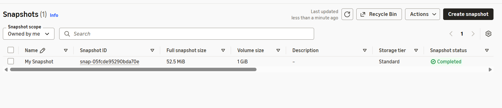
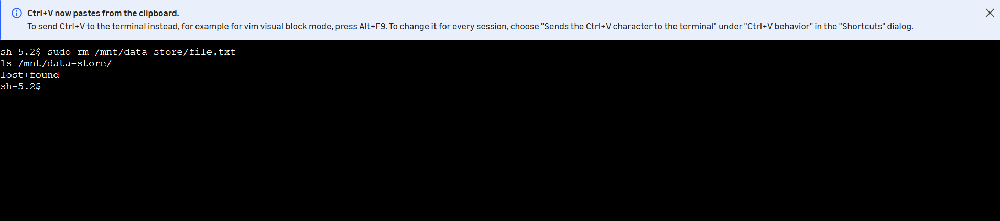
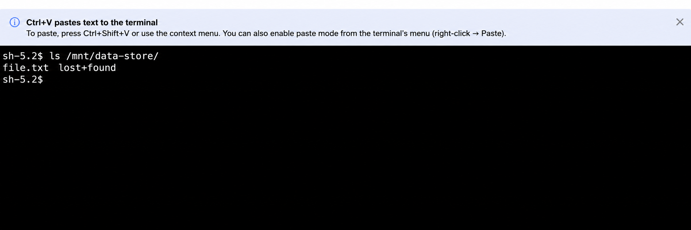

# Amazon EBS Lab: Create, Snapshot and Restore a Volume

A hands-on lab that walks through the full lifecycle of an Amazon EBS volume: creating it, attaching it to an EC2 instance, formatting and mounting it, taking a snapshot, and restoring the data after accidental deletion.



**Flow:** EC2 Instance → *Attached* → EBS Volume → *Created* → Snapshot

---

## Objectives

- Create an Amazon EBS volume
- Attach and mount the volume to an EC2 instance
- Create a snapshot of the volume
- Create a new volume from the snapshot
- Attach and mount the new volume and verify the data

## Key Concepts

| Concept | Description |
|---|---|
| **EC2 Instance** | A virtual server in the cloud. |
| **EBS Volume** | Persistent block storage attached to an instance. It lives independently of the instance. |
| **Snapshot** | A point-in-time backup of a volume, stored in Amazon S3. Only used blocks are copied. |
| **Availability Zone (AZ)** | A volume can only be attached to an instance in the **same AZ**. |

---

## Steps

### 1. Create the volume

In **EC2 → Volumes → Create volume**:

| Setting | Value |
|---|---|
| Type | General Purpose SSD (gp2) |
| Size | 1 GiB |
| Availability Zone | Same as the `Lab` instance |
| Tag | `Name` = `My Volume` |



### 2. Attach the volume

**Actions → Attach volume**, choose the `Lab` instance and the device name `/dev/sdb`.

### 3. Connect to the instance

**EC2 → Instances → Lab → Connect → Session Manager**, then switch to the standard user:

```bash
sudo su -l ec2-user
```

### 4. Create the file system and mount the volume

```bash
df -h                                   # view current disks (new volume not shown yet)
sudo mkfs -t ext3 /dev/sdb              # format the volume with ext3
sudo mkdir /mnt/data-store              # create the mount point
sudo mount /dev/sdb /mnt/data-store     # mount the volume
echo "/dev/sdb   /mnt/data-store ext3 defaults,noatime 1 2" | sudo tee -a /etc/fstab   # persist across reboots
cat /etc/fstab                          # verify the entry
df -h                                   # verify the volume is mounted
sudo sh -c "echo some text has been written > /mnt/data-store/file.txt"   # create a test file
cat /mnt/data-store/file.txt            # verify the content
```



| Command | Purpose |
|---|---|
| `df -h` | Show disk space in human-readable format |
| `mkfs -t ext3` | Create (format) an ext3 file system. **Erases existing data.** |
| `mkdir` | Create the directory used as the mount point |
| `mount` | Attach the device to a directory |
| `tee -a /etc/fstab` | Append the mount entry so it survives a reboot |
| `sh -c "... > file"` | Run the redirect with admin rights |

### 5. Create a snapshot

**Volumes → My Volume → Actions → Create snapshot**, tag it `Name` = `My Snapshot`, and wait until the status is **Completed**.



Then delete the test file to simulate an accidental deletion:

```bash
sudo rm /mnt/data-store/file.txt
ls /mnt/data-store/
```



Only `lost+found` remains, so the file is gone from the original volume.

### 6. Restore from the snapshot

1. **Snapshots → My Snapshot → Actions → Create volume from snapshot**
   - Same Availability Zone as the instance
   - Tag: `Name` = `Restored Volume`
2. **Volumes → Restored Volume → Actions → Attach volume**
   - Instance: `Lab`, device name: `/dev/sdc`
3. Mount it and verify:

```bash
sudo mkdir /mnt/data-store2
sudo mount /dev/sdc /mnt/data-store2
ls /mnt/data-store2/
```

`file.txt` is back, which confirms the restore worked. No `mkfs` is needed here because the file system was copied from the snapshot.



---

## Result

| Stage | State of `file.txt` |
|---|---|
| After writing | Present on `My Volume` |
| After snapshot | Present in `My Snapshot` |
| After `rm` | Deleted from `My Volume` |
| After restore | Present on `Restored Volume` |

## Notes

- Always create the volume in the **same AZ** as the instance.
- Wait for the snapshot status to be **Completed** before deleting data or restoring.
- Never run `mkfs` on a volume that already contains data.
- Device names may appear as `/dev/xvdb` and `/dev/xvdc` inside Linux. Use `lsblk` to confirm.
- At the end of the lab, choose **End Lab** to clean up the resources.


